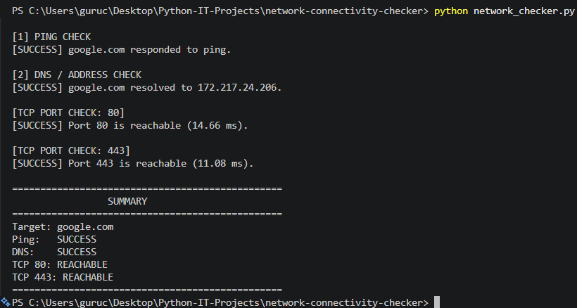

# Network Connectivity Checker

A Python-based network troubleshooting tool that checks host connectivity, resolves domain names to IP addresses, and tests TCP port reachability. It displays clear success and failure messages to help identify basic network connectivity issues.

## Features

- **Ping Check:** Checks whether a host responds to ping requests.
- **DNS Resolution:** Resolves a hostname to its IPv4 address.
- **TCP Port Checking:** Tests connectivity to user-specified TCP ports.
- **Input Validation:** Validates hostnames and port numbers.
- **Duplicate Port Handling:** Avoids checking the same port multiple times.
- **Error Handling:** Reports common connection failures, including connection refused and timeouts.
- **Summary Report:** Displays the results of ping, DNS, and TCP port checks.

## Technologies Used

- Python 3
- Socket Programming
- Subprocess Module
- Networking Fundamentals
- TCP/IP
- DNS

## Project Structure

```text
network-connectivity-checker/
├── network_checker.py
├── requirements.txt
├── README.md
├── .gitignore
└── network-checker-output.png
```

## Requirements

- Python 3 installed on your system.
- An active internet connection for testing external hosts.
- Windows, Linux, or another compatible operating system.

This project uses Python's standard library and does not require external packages.

## Installation and Setup

### 1. Clone the Repository

```bash
git clone https://github.com/GuruChandrayudu/network-connectivity-checker.git
```

### 2. Navigate to the Project Directory

```bash
cd network-connectivity-checker
```

### 3. Run the Program

```bash
python network_checker.py
```

## Usage

Run the Python script and enter the hostname or IP address you want to check. Then enter the TCP ports separated by commas.

Example input:

```text
Enter an IP address or hostname: google.com
Enter TCP ports (e.g. 80,443), or press Enter to skip: 80,443
```

The program performs ping, DNS resolution, and TCP port connectivity checks and displays a summary of the results.

## Live Execution Output

The following screenshot shows the successful execution of the Network Connectivity Checker. It demonstrates a successful ping response, DNS resolution, and reachable TCP ports 80 and 443 for `google.com`.



## Sample Output

```text
[1] PING CHECK
[SUCCESS] google.com responded to ping.

[2] DNS / ADDRESS CHECK
[SUCCESS] google.com resolved to an IP address.

[TCP PORT CHECK: 80]
[SUCCESS] Port 80 is reachable.

[TCP PORT CHECK: 443]
[SUCCESS] Port 443 is reachable.

SUMMARY
Target: google.com
Ping:   SUCCESS
DNS:    SUCCESS
TCP 80: REACHABLE
TCP 443: REACHABLE
```

*Note: This is an illustrative sample. The resolved IP address and connection response times may vary.*

## Test Cases

| Test Case | Expected Result |
|---|---|
| `google.com` with ports `80,443` | Successful connectivity checks when reachable |
| `github.com` with port `80` | TCP port reachability result |
| `127.0.0.1` with port `80` | Connection may be refused if no service is listening |
| `127.0.0.1` with port `65000` | Connection may be refused if no service is listening |
| `invalid.invalid` | DNS resolution failure |
| Duplicate ports such as `80,443,443` | Each unique port is checked once |
| Invalid hostname or port input | Validation error |

## Learning Outcomes

- Practiced Python socket programming.
- Understood basic DNS resolution and IP addresses.
- Learned how ping and TCP connection checks work.
- Practiced exception handling and input validation.
- Learned to interpret basic network connectivity results.
- Applied networking concepts through a practical Python project.

## Limitations

- A host may block ping requests even when it is online.
- A failed TCP connection does not always mean a port is closed; firewalls and network restrictions can also affect connectivity.
- The current implementation uses IPv4 hostname resolution.
- This tool provides basic connectivity diagnostics, not a comprehensive network scanning solution.

## Future Improvements

- Add IPv6 support.
- Export results to CSV or log files.
- Develop a graphical user interface.
- Generate detailed network diagnostic reports.
- Add repeated connectivity checks and latency summaries.

## Author

**Guru Chandrayudu**

GitHub: [GuruChandrayudu](https://github.com/GuruChandrayudu)

Project Repository: [Network Connectivity Checker](https://github.com/GuruChandrayudu/network-connectivity-checker)

## Disclaimer

This project is intended for educational purposes and basic network troubleshooting. Test only systems and networks you own or have permission to assess.